<!-- datasheet:banner -->
<p align="center">
  <picture>
    <source media="(prefers-color-scheme: dark)" srcset=".github/assets/banner-dark.svg">
    
  </picture>
</p>
<!-- /datasheet:banner -->

# Better VERT

**Convert almost anything to almost anything, on your own machine.**

Better VERT merges the format reach of [VERT](https://github.com/VERT-sh/VERT) with the document intelligence of [Microsoft MarkItDown](https://github.com/microsoft/markitdown), in one Docker container: 250+ formats through FFmpeg and ImageMagick, anything-to-Markdown with Tesseract OCR and Poppler, PDF merge and split, and a command line (`vert`) next to the web UI. It is tuned for Apple Silicon but runs the same on macOS, Linux and Windows, on x86-64 and ARM64. Everything runs **100% locally**: no file ever leaves your machine.

<!-- datasheet:figure -->
## At a glance

<p align="center">
  <picture>
    <source media="(prefers-color-scheme: dark)" srcset=".github/assets/diagram-dark.svg">
    
  </picture>
</p>

| Characteristic | Detail |
| --- | --- |
| **Run** | `./install.sh` builds and starts it; then open `http://localhost:8394` or use the `vert` command |
| **Converts** | 250+ formats in video, audio, image, document and data, plus cross-medium routes such as video to PDF storyboard |
| **Also does** | Anything to Markdown with OCR, PDF merge and split, a media inspector, batch folders |
| **Limits** | 2 GB per upload by default (`MAX_UPLOAD_MB`); the port listens on `127.0.0.1` only |
| **Requires** | Docker (Desktop, or Engine with the Compose plugin); `curl` for the `vert` command |
<!-- /datasheet:figure -->

## Quick start

```bash
git clone https://github.com/S-k404/better-vert.git
cd better-vert && ./install.sh     # checks prerequisites, builds, starts, offers to link `vert`
vert convert clip.mov --to mp4     # or open http://localhost:8394
```

## What makes it better

| Feature | Upstream VERT | File Converter (my earlier Markdown-only converter, now built in) | **Better VERT** |
|---|---|---|---|
| **Video Conversion** | Offloaded to external cloud (`vertd.vert.sh`) or separate Rust daemon | Not supported | **Local multi-threaded FFmpeg** (uses every core you give it) |
| **Anything &rarr; Markdown** | Limited (pandoc wasm) | Yes (`markitdown`) | **Fully integrated** (MarkItDown + Tesseract OCR + Poppler + live preview) |
| **Hardware Acceleration** | None by default | CPU only | **SIMD (NEON / AVX) + all-core threads + browser GPU + a host GPU bridge** (VideoToolbox, NVENC, Quick Sync, VAAPI, AMF) |
| **Upload Limits** | 10MB limit in Nginx | Unlimited | **2 GB per file by default** (`MAX_UPLOAD_MB`, raise as needed) |
| **Batch Processing** | Manual one-by-one | `./convert.sh` | **Both Web UI Batch Monitor & `./convert.sh` CLI** |
| **Docker Stack** | Complex multi-repo setup | Single container | **Single-command Compose stack** (`8394:8000`) |

## Requirements

Better VERT runs in Docker, so any machine that runs Docker runs it. The image
is multi-architecture (`python:3.12-slim` plus distro packages), so there is
nothing to select for x86-64 versus ARM64.

| Host | Docker | `vert` CLI + `install.sh` | Notes |
|---|---|---|---|
| **macOS** (Apple Silicon or Intel) | Docker Desktop | Terminal (bash 3.2+ is fine) | Everything works. Host GPU via VideoToolbox |
| **Linux** (x86-64 or ARM64) | Docker Engine + Compose plugin (or `docker-compose` v1) | Any shell with bash | `install.sh` pins `VERT_UID`/`VERT_GID`, handles root and SELinux hosts |
| **Windows 10/11** | Docker Desktop (WSL2 backend) | **WSL2** (recommended); Git Bash is best effort | The web UI needs no shell at all, see [Option B](#option-b--plain-docker-compose) |

- `curl` (required by the CLI); `jq` and `unzip` are optional but improve `vert status`/`vert md` output
- Optional, for the host GPU helper `./scripts/gpu-accelerator.sh` only: a native `ffmpeg` on the host (`brew install ffmpeg`, `winget install Gyan.FFmpeg`, or your distro's package). The Docker container itself doesn't need this

## Install and run

### Option A — one-line install (recommended)

Run this in a macOS/Linux terminal, or in **WSL2** on Windows (Git Bash is best effort).
On Windows, clone inside your WSL home (`~/`), not under `/mnt/c`: bind mounts
on the Windows drive are much slower.

```bash
git clone https://github.com/S-k404/better-vert.git
cd better-vert
./install.sh
```

The installer checks your prerequisites, writes a `.env`, builds the image,
waits for the API to come up, and offers to put the `vert` command on your PATH.

```
./install.sh --no-start      # set up config only
./install.sh --link          # install `vert` without prompting
./install.sh --no-link       # skip the PATH step
./install.sh --prefix ~/bin  # choose where `vert` is linked
```

Then open **[http://localhost:8394](http://localhost:8394)**.

### Option B — plain Docker Compose

```bash
cp .env.example .env   # optional: change the host port
docker compose up -d --build
```

On Windows PowerShell, use `Copy-Item .env.example .env` for the first line.
On a Linux host, also set `VERT_UID`/`VERT_GID` in `.env` to `id -u`/`id -g` (see
[Troubleshooting](#troubleshooting)).

To stop: `docker compose down` (or `vert down`).

## Typical application

```bash
# 1. A phone video to something smaller, at a chosen quality and size
vert convert clip.mov --to mp4 --crf 20 --resolution 1920x1080

# 2. A pile of reports and slides to Markdown notes (OCR included)
vert md report.pdf slides.pptx -o ./notes

# 3. A whole folder, no questions asked
./convert.sh ~/Desktop/research-papers
```

## Command line tool

`vert` drives the whole stack from your terminal. Run it with no arguments for an
interactive picker with arrow-key navigation, the same format categories as the
web UI, and a live progress bar:

```bash
vert
```

```
  Better VERT · local universal conversion
  http://127.0.0.1:8394

What would you like to do?  (↑/↓ move · enter select · q cancel)
  ❯ Convert a file to another format
    Convert files to Markdown
    Inspect a file
    Batch-convert ./input
    Show system status

Target category  (↑/↓ move · enter select · q cancel)
    🎬 Video
  ❯ 🎧 Audio
    🖼  Image
    📄 Document
    📊 Data
    ✨ Cross-medium

  ████████████████████░░░░░░░░░░░░░░  60%  podcast.wav → flac  6s
```

Or use it non-interactively:

```bash
vert up --build                 # start the stack and wait until it answers
vert convert clip.mov --to mp4 --crf 20 --resolution 1920x1080
vert md report.pdf slides.pptx -o ./notes
vert inspect movie.mkv          # codec / stream / metadata telemetry
vert batch                      # convert everything in ./input
vert formats video               # what you can convert to
vert status                     # health + hardware acceleration telemetry
vert open                       # open the web UI
vert down
```

Also: `vert ls` shows what is in `./input` and `./output`, `vert logs -f` follows the container log, and `vert i` is the same as a bare `vert`. `vert convert` takes `--fps`, `--quality`, `--codec`, `--audio-bitrate`, `--trim-start`, `--trim-duration`, `--speed`, `--dpi` and `--loudnorm` besides `--crf` and `--resolution`; `vert formats` without a category shows all six (video, audio, image, document, data, cross).

Full command and flag reference: **[docs/CLI_REFERENCE.md](docs/CLI_REFERENCE.md)**.

## Features

### 1. Universal 250+ Format Converter
Convert between video, audio, image, and document formats using every available CPU
core (`-threads 0`, with NEON or AVX SIMD) for video, ImageMagick for images, and
Pandoc/Poppler for documents. Full per-category format tables and the tuned
FFmpeg encoder presets behind each target: **[docs/FORMATS.md](docs/FORMATS.md)**.

### 2. Anything &rarr; Markdown Studio (Incorporating File Converter)
Drag & drop Office documents, PDFs (with text & table layer extraction via
Poppler and OCR fallbacks), web/data formats, images, audio, or zipped
archives, and get back structured Markdown — with EXIF/metadata extraction,
Tesseract OCR, and speech transcription where relevant. A live rendered
preview (formatted HTML or raw markdown), instant copy, and either individual
`.md` downloads or **"Convert & Download .ZIP"**. Converted `.md` files are
also saved directly to `./output/` on your machine.

### 3. Batch Folder Automation (CLI & UI)
Drop any files into `./input/` on your machine, then run:

```bash
./convert.sh
```

Or pass any folder path to convert it automatically:

```bash
./convert.sh ~/Desktop/research-papers
```

Converted files immediately land in `./output/`.

### 4. Native Host GPU Acceleration
Docker can't reach the GPU on macOS or Windows, so for massive 4K/8K video
conversions run the helper directly on the host. It picks the hardware encoder
your machine can really use, test-encodes it first, and falls back to software
x264/x265 if none works:

```bash
./scripts/gpu-accelerator.sh input.mov output.mp4 hevc
```

| Host | Encoder used |
|---|---|
| macOS | VideoToolbox (`hevc`, `h264`, `prores`) |
| NVIDIA GPU (Linux, Windows) | NVENC |
| Intel GPU (Linux, Windows) | Quick Sync (QSV) |
| AMD / Intel GPU (Linux) | VAAPI |
| AMD GPU (Windows) | AMF |

Codecs are `hevc` (default), `h264` and `prores`. Force a backend with
`VERT_HWACCEL=nvenc` (or `videotoolbox|qsv|vaapi|amf|software`). The old
`./scripts/mac-gpu-accelerator.sh` still works and calls the same script.

### 5. The web app, tab by tab
Open [http://localhost:8394](http://localhost:8394). There are six tabs:

| Tab | What it does |
|---|---|
| **Converter** | Pick a category and a target format, drop files in, watch the progress |
| **Markdown Studio** | Anything to Markdown with MarkItDown, OCR and a live preview |
| **PDF Studio** | Merge several PDFs into one, or split a PDF into pages or pull out a page range (Poppler) |
| **Inspector** | Stream, codec and metadata probe for any file (`vert inspect` does the same) |
| **Batch Folder** | Converts everything in `./input` to `./output` |
| **Settings** | Default target formats, default encoding and quality (CRF, codec, audio bitrate, image quality), workflow automation and hardware telemetry |

### 6. Cross-medium conversions
Some targets are pipelines rather than re-encodes: a **PDF storyboard** from a video (keyframes plus telemetry), a neon **waveform video** from audio, a **transcript** in Markdown from audio, a **ZIP of page images** and embedded figures from a document, plus Image to SVG, Video to GIF and Data to XLSX. The full table is in [docs/FORMATS.md](docs/FORMATS.md#cross-medium-routes-post-apiconvert-universal-with-a-cross-target).

## Security notes

This stack processes untrusted files (anything you drop on it) through FFmpeg,
ImageMagick, Tesseract, Poppler and Pandoc, so it is set up to stay local:

| Control | Default |
|---|---|
| **Network exposure** | Published on `127.0.0.1` only — not reachable from your LAN |
| **CORS** | Restricted to local origins via `ALLOWED_ORIGINS`; credentials disabled |
| **Container user** | Runs as non-root `vert` (uid 10001) with `no-new-privileges` |
| **Upload size** | Capped at `MAX_UPLOAD_MB` (2 GB default) per file |
| **Filenames** | Every client-supplied filename is reduced to a safe basename before it touches disk |
| **Error responses** | Conversion failures log full detail server-side and return a generic message |

There is **no authentication** — the loopback binding is what keeps it private.
If you expose this beyond `localhost`, put an authenticating reverse proxy in
front of it and set `ALLOWED_ORIGINS` accordingly.

`./output/` and `./input/` are git-ignored, since they hold your actual documents.

Full write-up, including why each control is there: **[docs/ARCHITECTURE.md#security-model](docs/ARCHITECTURE.md#security-model)**.

## Absolute maximum ratings

| Parameter | Limit |
|---|---|
| Upload size | 2 GB per file by default (`MAX_UPLOAD_MB`, raise it in `.env`) |
| Web port | `8394` on `127.0.0.1` only (`PORT` in `.env`) |
| Formats | 250+ across video, audio, image, document, data and cross-medium targets |
| CLI needs | `curl`; `jq` and `unzip` are optional |
| Host GPU | only through `./scripts/gpu-accelerator.sh` on the host, since Docker cannot reach the GPU on macOS or Windows |
| Files sent to a third-party server | 0 |

## Errata

* On Windows use WSL2 and keep the clone in your WSL home (`~/`), not under `/mnt/c`, where bind mounts are much slower. Git Bash is best effort.
* `vert formats` shows the live catalogue when the stack is running and a built-in list when it is not.
* On a Linux host, set `VERT_UID` and `VERT_GID` in `.env` (the installer does it for you) so output files are not owned by root.

## Troubleshooting

| Symptom | Fix |
|---|---|
| `install.sh` dies on "Docker daemon isn't running" | Start Docker Desktop, then re-run `./install.sh` |
| `vert` says "is not responding on http://127.0.0.1:8394" | The container isn't up — run `vert up` (or `docker compose up -d`), then `vert logs` if it still fails |
| Build takes a long time on first run | Expected — the image pulls `ffmpeg`, `tesseract`, `poppler`, `pandoc` and friends; subsequent builds are cached |
| Container can't write to `./output`/`./input` on Linux | Set `VERT_UID`/`VERT_GID` in `.env` to your host `id -u`/`id -g` (macOS/Windows Docker Desktop doesn't need this; `install.sh` sets it automatically on Linux). If you run as root, leave them unset and run `chown 10001:10001 input output` |
| "Permission denied" on `./output` on Fedora / RHEL / Rocky | SELinux is blocking the bind mount. Set `VERT_MOUNT_OPTS=:z` in `.env` (`install.sh` does this when SELinux is enforcing) |
| `docker compose` is "not a docker command" on an older Linux | Install the Compose plugin, or the standalone `docker-compose` v1: the scripts use either |
| `$'\r': command not found` when running a script on Windows | The script was checked out with CRLF line endings. Re-clone, or run `git config core.autocrlf input` then `git checkout -- .`. The repo's `.gitattributes` forces LF for new clones |
| Conversions are very slow on Windows | The project folder is on the Windows drive (`/mnt/c/...`). Clone it into your WSL home (`~/`) instead |
| A conversion fails with a generic error | Run `vert logs` (or `docker compose logs better-vert`) — the real exception is logged server-side; the HTTP response intentionally doesn't leak internal paths |
| Upload rejected as too large | Raise `MAX_UPLOAD_MB` in `.env` and restart the stack |
| `vert formats` only shows the static list | The API isn't reachable — it falls back to a built-in list when the container is down; `vert up` first for the live catalogue |

## Project structure

```
better-vert/
├── backend/
│   ├── app.py                   # FastAPI application with CORS, COOP/COEP, and telemetry
│   ├── markitdown_engine.py     # Microsoft MarkItDown + Tesseract OCR + Poppler fallbacks
│   ├── media_engine.py          # FFmpeg & ImageMagick converter, multi-threaded across all cores
│   └── requirements.txt         # Pinned dependencies
├── frontend/
│   ├── index.html               # Dark mode UI
│   ├── style.css                # Glassmorphism, CSS grid, micro-animations
│   └── app.js                   # Universal & Markdown controller with marked.js
├── input/                       # Drop files here for batch conversion
├── output/                      # Converted files land here directly on your machine
├── scripts/
│   ├── vert                     # Command line client (interactive + scriptable)
│   ├── convert.sh               # CLI batch converter
│   ├── gpu-accelerator.sh       # Host GPU encode helper (VideoToolbox / NVENC / QSV / VAAPI / AMF)
│   ├── mac-gpu-accelerator.sh   # Back-compat shim for gpu-accelerator.sh
│   └── lib/platform.sh          # OS detection, compose v1/v2, browser opener (sourced)
├── docs/                        # Deeper reference docs (formats, CLI, architecture)
├── install.sh                   # Prerequisite check, build, start, PATH setup
├── convert.sh                   # Root shortcut for scripts/convert.sh
├── .env.example                 # Copy to .env to override port / upload limit
├── Dockerfile                   # Multi-arch (amd64 + arm64) image: Python 3.12, FFmpeg, Tesseract, Poppler
├── docker-compose.yml            # Compose configuration (loopback-only port, SELinux-aware mounts)
└── README.md
```

## Documentation

- **[docs/FORMATS.md](docs/FORMATS.md)** — full format tables per category, cross-medium routes, and the Markdown conversion matrix
- **[docs/CLI_REFERENCE.md](docs/CLI_REFERENCE.md)** — every `vert` command and conversion flag
- **[docs/ARCHITECTURE.md](docs/ARCHITECTURE.md)** — component layout, request flow, hardware acceleration, and the security model

## Contributing

This is a personal build, developed mainly on Apple Silicon and designed to run
on any host Docker supports (macOS, Linux, Windows; x86-64 and ARM64). Issues and PRs that fix a real bug or extend
format support are welcome — open an issue describing the input/output
formats and host OS before sending a PR.

## License

MIT — see [LICENSE](LICENSE).

<!-- datasheet:footer -->
---

<p align="center">
  <a href="https://github.com/S-k404/music-tools">&larr; U3 music-tools</a> &middot;
  <a href="https://github.com/S-k404/S-k404">SK-404 index</a> &middot;
  <a href="https://github.com/S-k404/music-visualiser">U5 music-visualiser &rarr;</a>
</p>
<!-- /datasheet:footer -->
